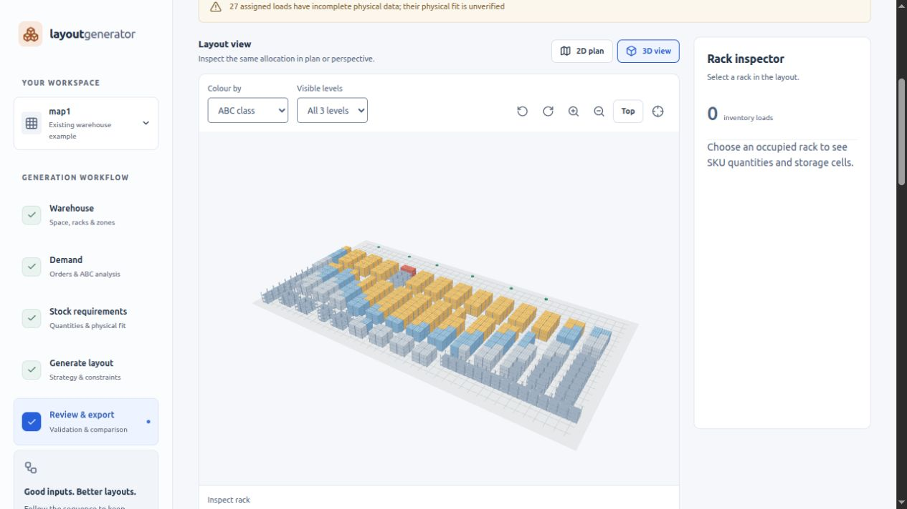

# 3D layout view validation

Added on 2026-10-31 in `/home/usern/layout_generator`. The viewer is available under **Review & export → 3D view**, next to the 2D plan. It renders existing generated assignments; no C++ allocation, stock, routing or validation algorithm was changed.

## Checks

- **31 automated tests pass:** the existing 26 engine/API checks plus five scene-model tests. See `3d-automated-tests.tap`.
- Scene tests verify contiguous multi-cell footprints, level cutaways, source-data immutability, explicit slot geometry, legacy coordinates on occupied units, empty cells, configured ASRS buffer subsets, omission of unassigned/unknown cells, and the real AMR example's **342 racks / 4,104 cells**.
- Browser rendering uses the saved real result: **3,268 assigned loads**, all displayed in the scene. Direct picking selected rack `G15_14`; the shared inspector showed its 12 inventory loads. Isolation showed 12 cells / 12 allocations. A level-1 cutaway showed four cells / four allocations while the inspector retained all 12 loads.
- Both ABC and zone colour modes were exercised. Selection persisted when switching to 2D and back; renderer resources are released when leaving the 3D view.
- The 375px check rendered a WebGL canvas without page overflow. Camera controls wrap to their own row and rack selection provides an alternative to precise pointer picking. The desktop view was checked at 1,265px.
- The dependency audit reports zero known vulnerabilities. Three.js is bundled locally and lazy-loaded only when opening 3D. Repeated geometry uses instanced meshes; rendering is requested on interaction/resize rather than continuously while idle.

## Meaning and limits

The blocks represent **allocated storage volume**, not individual product shapes. A multi-cell load uses the full union of its occupied cells. Unassigned stock is not placed in the scene. Missing physical data remains visibly marked as unverified.

Explicit coordinates/dimensions are authoritative. Older files lacking them use a schematic rack derived from grid spacing and rack settings (default height 3.1 m and clearance 0.05 m). Those dimensions are labelled as estimated in the interface. Cutaways and isolation change visibility only; the inspector always lists the whole rack.

WebGL 2 is required. The app provides a 2D fallback and handles graphics initialization/context failures, but unsupported-GPU failure was not forced in the browser test. The mobile check verifies responsive layout in a 375px frame, not performance on physical phone hardware. This view does not add traffic simulation or a manufacturing/CAD model.

