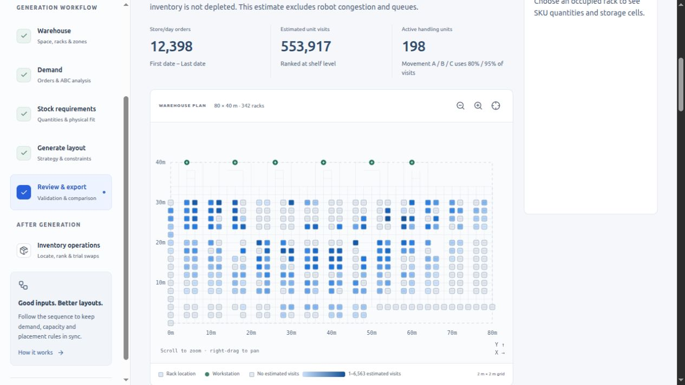
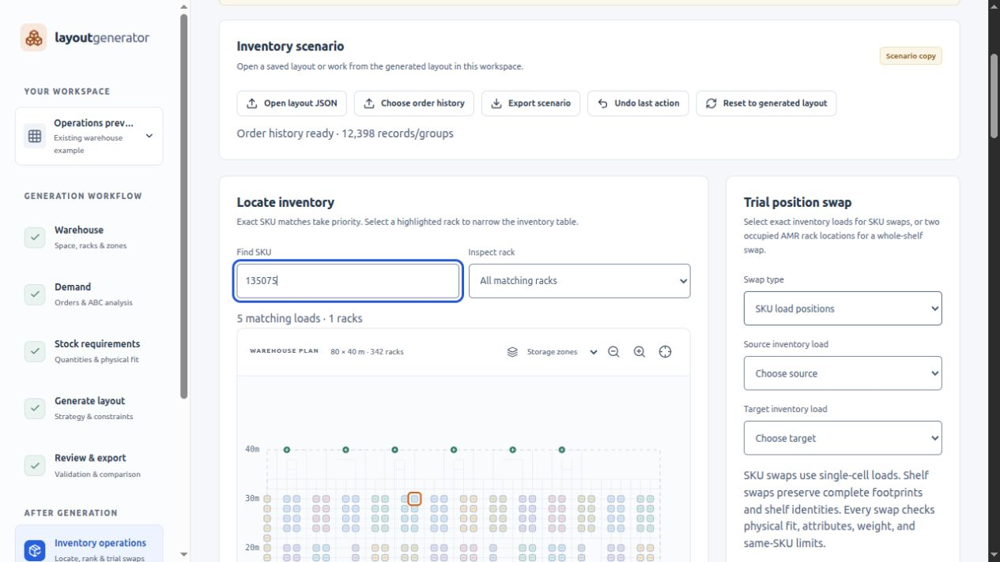

# Rack movement and inventory operations validation

All 49 automated tests pass, including HTTP movement jobs, validated swaps, shelf identity, multi-cell footprints, incompatible swaps, weight limits, scenario JSON round-trip validation and SKU lookup.

## Desktop comparison

The same 12,398 historical Store ID + Date groups were fed to the C++ implementation and the original desktop movement function. Counts, ranks, visit shares, movement classes and unit identities match exactly.

| Layout | Assigned loads | Ranked units | Estimated visits | Native wall time | Comparison |
|---|---:|---:|---:|---:|---|
| saved-layout | 3,268 | 198 | 553,917 | 1.58 s | Exact |
| reference-amr-layout | 3,335 | 197 | 553,086 | 1.59 s | Exact |
| reference-asrs-layout | 3,335 | 3,314 | 907,648 | 2.46 s | Exact |

[Machine-readable movement evidence](movement-validation.json). The Basic generation comparisons were rerun after sharing the result builder with trial swaps: all 3,335 placements match in each of three cases; all 1,524 stock summaries match numerically. See [generation comparison](migration-validation.json).

## Browser checks

On an isolated copy of the saved 3,268-load layout: calculated and rendered the heat map; found five exact SKU loads on one rack; validated an exact-load swap and restored its address with Undo; swapped two whole shelves with movement recalculation; verified the scenario survives switching sections. The original saved workspace remains at revision 18 with SHA-256 `7dcba7379fee957618da502c4f13e3e600d9ea3e510342e4a8f7d259d4888927`. The temporary preview was closed and removed; the updated application is running at http://127.0.0.1:4317.

## Scope

Movement is a historical visit estimate with no stock depletion, robot congestion, queues or fleet timing. Scenarios require JSON export to persist across reloads. Desktop interaction was checked; the responsive controls were implemented but mobile browser interaction was not rechecked. Python is used only for the optional comparison script, not by the shipped application.
